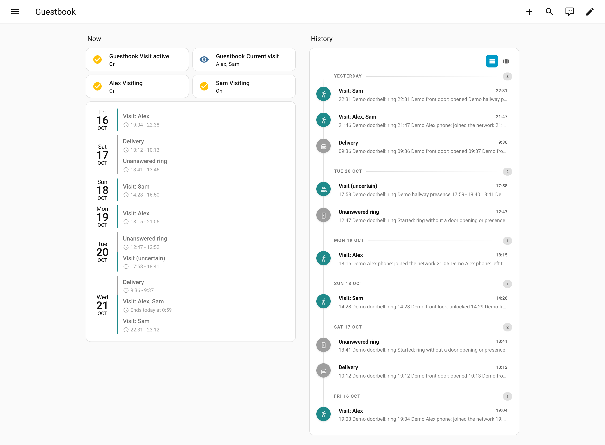
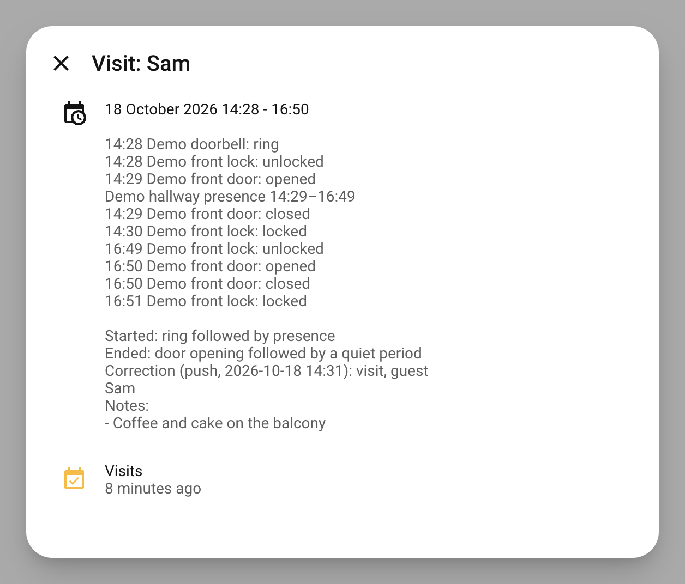

# Guestbook

A Home Assistant integration that keeps a guestbook of who visited your home.

Typical do-it-yourself visit logs write into `input_text` helpers, which stop at 255 characters, and presence sensors flood them with noise. Guestbook turns your doorbell, door contacts, presence sensors, locks and your guests' phones into **visits**. Each visit becomes one calendar event with the full log in its description. You also get sensors for "is someone here right now", bus events for your automations, pushes with a "Who was that?" question, and a JSONL export so you can tune the rules.

All data stays on your Home Assistant. There is no cloud and no telemetry.

## Screenshots

A dashboard with the Guestbook entities, [Calendar Card Pro](https://github.com/alexpfau/calendar-card-pro) and [Chronicle Card](https://github.com/KadenThomp36/chronicle-card). All names and entities are demo data.

<picture>
  <source media="(prefers-color-scheme: dark)" srcset="docs/images/dashboard-dark.png">
  
</picture>

Each visit is a calendar event. Its description holds the full log:



## What it does

- A guest's phone joins your Wi-Fi: a **certain** visit starts. It ends when the last phone has left.
- Someone rings and then the door opens or presence is detected, and no resident is involved: an **uncertain** visit starts. This covers guests without a phone.
- A ring that comes with a resident signal (your fingerprint, your phone) is you coming home. It is never a visit.
- A ring with nothing after it is an **unanswered ring**, shown in a separate calendar.
- For uncertain visits Guestbook asks you on your phone what it was. Your answer is stored next to the original decision.

## Requirements

- Home Assistant 2026.10 or newer.
- At least one source you want to watch. Every source is optional, so Guestbook works with whatever hardware you have.
- For visits by phone: a `device_tracker` for the guest's phone, for example from your router integration.
- For pushes with buttons: the Home Assistant Companion app on your phone.

## Installation

Guestbook is installed through [HACS](https://hacs.xyz) as a custom repository.

1. In HACS open the three-dot menu, then **Custom repositories**.
2. Add `https://github.com/DigitalIQ/ha-guestbook` with the type **Integration**.
3. Search for **Guestbook** in HACS and download it.
4. Restart Home Assistant.
5. Go to **Settings > Devices & services > Add integration** and pick **Guestbook**.

## Setup

The setup form asks for your sources. Every field is optional, and you can change all of them later.

| Field | What to select |
| --- | --- |
| Doorbells | `event` entities or `binary_sensor` entities. A ring starts the ring window. |
| Door contacts | Contacts of the doors a guest comes through. |
| Presence sensors | Presence or motion sensors inside the home. |
| Locks | Locks whose changes should show up in the visit log. |
| Residents | `person` entities of the people who live here. |
| Resident signals | Entities that prove a resident is arriving: a fingerprint reader, a resident phone tracker, a "opened by resident" sensor. |

### Guests

Guests are added on the Guestbook entry page (**Settings > Devices & services > Guestbook > Add guest**). A guest has a name and one or more phones, selected as `device_tracker` entities. Every guest also gets a binary sensor that is on while that guest is visiting. You can edit or remove a guest later.

If you correct a visit and name a guest that does not exist yet, Guestbook raises a repair that offers to create the guest. The phones that were home during that visit and belong to nobody are preselected, so linking the right phone is one click. A device that is always home, such as a TV, is preselected too. Remove it in the form.

### Apple Watch or iPhone as resident signal

A resident phone that joins the Wi-Fi is a good resident signal, but it fails when the phone stays at home. A watch on your wrist comes home with you. Home Assistant can track an Apple Watch or iPhone over Bluetooth with the core integration [Private BLE Device](https://www.home-assistant.io/integrations/private_ble_device/), and Guestbook can use that tracker as a resident signal without any extra code.

What you need:

- Bluetooth in Home Assistant that reaches your front door: a Bluetooth adapter or an [ESPHome Bluetooth proxy](https://esphome.io/components/bluetooth_proxy.html) near the entrance.
- The watch's Identity Resolving Key (IRK). Apple devices change their Bluetooth address about every 15 minutes; the IRK lets Home Assistant recognise them anyway.

Steps:

1. **Get the IRK.** On a Mac signed in to the same iCloud account, open Keychain Access and look up the watch's Bluetooth record, as described in the [Private BLE Device docs](https://www.home-assistant.io/integrations/private_ble_device/#getting-your-identity-resolving-key-irk). Without a Mac, an ESP32 running an ESPHome IRK capture component can read the key when you pair the watch with it (for example the [packages by Derek Seaman](https://github.com/DerekSeaman), MIT).
2. **Add Private BLE Device** under **Settings > Devices & services > Add integration** and paste the IRK. The watch must be switched on and in range. Home Assistant creates a `device_tracker` that is `home` while a Bluetooth scanner hears the watch.
3. **Select the tracker as a resident signal** in the Guestbook options (**Configure > Residents**). Guestbook counts it when it changes to `home`.

Good to know:

- The tracker turns `home` on the first advertisement it hears, so your arrival counts within seconds. It turns `not_home` only when Home Assistant has not heard the watch for a while (up to about 15 minutes by default). If you leave and come back within that time, there is no new change to `home`, and the ring counts as a visit. Correct it with the **That was me** button.
- Range matters. If the watch is heard from inside the home all the time, it never changes to `home` on arrival. Place the scanner so that it covers the entrance, not the whole home.
- Only residents can do this. A guest's iPhone cannot be recognised over Bluetooth, because Guestbook would need that guest's IRK. Guests are recognised by their phone in the Wi-Fi.
- Room-level trackers such as Bermuda or NeonPlan 3D report a room name, not `home`. To use one, create a template binary sensor that is `on` while the tracker reports your entrance area, and select that as the resident signal. Be careful: a resident who is already home and walks to the door to let a guest in would then turn a real visit into a resident arrival.

### Options

Open the Guestbook entry and choose **Configure**. The menu has four parts, and each part saves on its own and applies at once. Stored entries and open visits are kept.

- **Sources**: doorbells, door contacts, presence sensors, locks.
- **Residents**: residents and resident signals.
- **Rules**: the numbers behind the decisions.
- **Pushes**: who gets pushes and which pushes are sent.

| Rule | Default | What it controls |
| --- | --- | --- |
| Ring window | 5 minutes | Time after a ring in which a door opening or presence turns it into a visit. |
| Resident window | 3 minutes | A resident signal this long before a ring, up to the end of the ring window, makes it a resident arrival. |
| Quiet period | 10 minutes | An uncertain visit ends at a door opening that is followed by this much quiet. |
| Entry grace | 2 minutes | Door openings this soon after the guest came in do not count as leaving. |
| Phone grace | 5 minutes | A guest phone must stay away this long before it counts as left. |
| Maximum duration | 4 hours | An uncertain visit with no detected end stops after this time. |
| Keep entries for | 365 days | Retention. Closed entries older than this are deleted. |

Push options:

| Option | Default |
| --- | --- |
| Arrival | on |
| End of visit | on |
| Correction question | on |
| Unanswered ring | off |
| Open dashboard path | empty |

**Open dashboard path**: a path inside Home Assistant, for example `/lovelace/guestbook`. When it is set, every push to a Companion app phone opens that dashboard when you tap it (Guestbook sends `url` for iOS and `clickAction` for Android). Text-only targets do not get it.

## How visits are detected

In plain words:

1. **A guest phone comes home.** A certain visit starts, with that guest. A second guest arriving while the visit is open joins the same visit. The visit ends when all its guest phones have been away longer than the phone grace. The end time is the moment the last phone went away.
2. **A ring, then a door opening or presence, within the ring window.** An uncertain visit starts. A door opening or presence with no ring before it starts nothing, because it is just you leaving and coming back.
3. **A ring with a resident signal close to it** is a resident arrival. The resident signal can come from a selected entity (it counts when it changes to `on`, `home` or `unlocked`, or when an `event` entity gets a new event) or from the action `guestbook.resident_unlock`. Resident arrivals are stored but shown in no calendar.
4. **A ring with no door opening and no presence** is an unanswered ring.
5. **An uncertain visit ends** at the first door opening after which the door stays closed for the quiet period. The end time is that door opening. Door openings in the entry grace right after the guest came in are ignored. If no end is detected, the visit stops after the maximum duration.
6. **A guest phone joining an uncertain visit** makes it certain and adds the guest. You get one visit, not two.
7. **Restarts do not split visits.** Open visits continue after a restart of Home Assistant.

Every entry stores the reason why the rules decided what they decided (`ring_then_door`, `ring_then_presence`, `resident_signal`, `ring_no_entry`, `guest_phone`, `guest_phone_at_start` for the start; `door_then_quiet`, `max_duration`, `guests_left`, `corrected` for the end).

If one source is unavailable, the others keep working. If a selected entity does not exist, Guestbook raises a repair issue.

## Entities

With the default names, Guestbook creates these entities. Your entity ids may differ.

| Entity | What it shows |
| --- | --- |
| `binary_sensor.guestbook_visit_active` | On while any visit is open. |
| `sensor.guestbook_current_visit` | The guests of the current visit, or "Unknown guest" ("Unbekannter Gast" in German) when nobody is known. Unknown while no visit is open. Attributes: `entry_id`, `start`, `certainty`. Attributes stay small on purpose, so the recorder keeps storing them. |
| `binary_sensor.<guest>_visiting` | One per guest, on while that guest is visiting. It goes off when all the guest's phones have been away for the phone grace period, even if the visit goes on with another guest. |
| `sensor.guestbook_latest_entry` | The entry that the buttons and the actions without `entry_id` would change: the title as in the calendar (for example "Visit (uncertain)"). Attributes: `entry_id`, `start`, `end` (empty while the visit is open), `kind` (what the entry counts as now, after your correction) and `corrected` (`true` when you corrected it). Unknown while there is no entry. |
| `text.guestbook_guest_name` | The name the "Visit" button uses. Up to 64 characters, empty by default, kept across restarts. |
| `button.guestbook_that_was_me`, `button.guestbook_delivery`, `button.guestbook_don_t_know`, `button.guestbook_visit` | "That was me", "Delivery", "Don't know" and "Visit" ("War ich", "Lieferung", "Weiß nicht", "Besuch" in German). Each press corrects the latest entry. See [Correct from the dashboard](#correct-from-the-dashboard). |
| `calendar.guestbook_visits` | One event per visit. |
| `calendar.guestbook_rings` | Unanswered rings and entries you corrected to a delivery. |

## Calendars

A visit is one calendar event from arrival to departure. An ongoing visit ends "now". The title names the guests (`Visit: Alex`) or says `Visit (uncertain)` when nobody is known. The description holds the chronological log with presence changes are condensed to one line per sensor and stretch, for example `Hall presence 14:02–14:40`. An entry keeps at most 1000 signals. A visit that runs for weeks drops its oldest door, presence and lock signals first (never rings, guest phones or the signal that started the visit), and the description ends with `… N older signals not kept`. The texts follow your Home Assistant language (English or German).

Resident arrivals appear in no calendar. They stay in the storage and the export.

Both calendars are standard Home Assistant `calendar` entities, so any calendar card can show them:

- **Calendar Card Pro**: add `calendar.guestbook_visits` to the card's entities and add `calendar.guestbook_rings` as a second entity with another color if you want to see the rings too. Check the card's options for showing the event description.
- **Chronicle Card**: select `calendar.guestbook_visits` as the source. A separate card for `calendar.guestbook_rings` keeps deliveries out of the visit list.

Both cards are separate projects. See their documentation for the exact options.

Guest names are trimmed and cut to 64 characters everywhere (guest profile, `guest_name`, `add_visit`, text reply of the push).

## Bus events

All times are ISO strings in UTC. `guests` is a list of names.

| Event | When | Payload |
| --- | --- | --- |
| `guestbook_visit_started` | A visit starts, or an uncertain ring turns into a visit. | `entry_id`, `guests`, `certainty` (`certain` or `uncertain`), `start` |
| `guestbook_visit_event` | A signal is added to an open visit. | `entry_id`, `guests`, `certainty`, `signal`, `source` (entity id), `time` |
| `guestbook_visit_ended` | A visit ends. | `entry_id`, `guests`, `certainty`, `start`, `end`, `duration` (seconds), `reason` |
| `guestbook_visit_corrected` | A correction is saved. | `entry_id`, `kind`, `guest_name`, `guests`, `certainty`, `start`, `end` (`guests`, `start` and `end` as they count after the correction) |

`signal` is one of `ring`, `door_open`, `door_close`, `presence_on`, `presence_off`, `lock`, `guest_home`, `guest_away`, `resident`. `reason` of the end event is `door_then_quiet`, `max_duration`, `guests_left`, `corrected` or `resident_arrival`.

## Actions

| Action | Fields | What it does |
| --- | --- | --- |
| `guestbook.resident_unlock` | `source` (optional text) | Reports that a resident is arriving, so a ring close to it is not a visit. |
| `guestbook.correct_entry` | optional `entry_id`, `kind` (`resident`, `delivery`, `visit`, `unknown`), optional `guest_name`, `start`, `end`, `note` | Tells Guestbook what an entry really was. Without `entry_id` it corrects the latest entry. Returns the corrected entry when called with a response. |
| `guestbook.add_visit` | `guests` (a name or a list of names, none of them empty), `start`, `end`, optional `note` | Logs a visit the sensors missed. |
| `guestbook.add_note` | optional `entry_id`, `note` | Adds a free-text note to an entry. Without `entry_id` it notes the latest entry. |
| `guestbook.export` | optional `start`, `end` | Writes the entries to a JSONL file. Returns `path` and `count`. Admin users only. |

About corrections:

- `resident` removes the visit from the visits calendar. It stays in the storage and the export.
- `delivery` moves the entry to the rings calendar.
- `visit` moves an unanswered ring to the visits calendar. Use it with `guest_name` to name the guest.
- `unknown` keeps the entry where the rules put it.
- The original decision and reason are always kept next to your correction.
- `start` and `end` replace the times shown in the calendar. They do not stop an open visit.
- A ring that is still inside its ring window cannot be corrected yet.

You find the `entry_id` in the attributes of `sensor.guestbook_latest_entry` and `sensor.guestbook_current_visit`, in the bus events, and in the push texts.

The latest entry is the entry with the most recent start that is a visit or an unanswered ring, open or closed. Rings that still wait for their ring window and resident arrivals are never chosen. An entry that you corrected stays the latest one, so you can correct it again. When there is no such entry, the action stops with an error.

## Correct from the dashboard

The correction question on your phone needs the push. The buttons work from any dashboard, also when you are at home or missed the push. `sensor.guestbook_latest_entry` shows which entry a press will change.

```yaml
type: vertical-stack
cards:
  - type: entities
    entities:
      - entity: sensor.guestbook_latest_entry
      - entity: text.guestbook_guest_name
  - type: horizontal-stack
    cards:
      - type: button
        entity: button.guestbook_that_was_me
        name: That was me
        tap_action:
          action: perform-action
          perform_action: button.press
          target:
            entity_id: button.guestbook_that_was_me
      - type: button
        entity: button.guestbook_delivery
        name: Delivery
        tap_action:
          action: perform-action
          perform_action: button.press
          target:
            entity_id: button.guestbook_delivery
      - type: button
        entity: button.guestbook_don_t_know
        name: Don't know
        tap_action:
          action: perform-action
          perform_action: button.press
          target:
            entity_id: button.guestbook_don_t_know
      - type: button
        entity: button.guestbook_visit
        name: Visit
        tap_action:
          action: perform-action
          perform_action: button.press
          target:
            entity_id: button.guestbook_visit
```

To name a guest, type the name into the text field first and press "Visit". Without a name, "Visit" makes a visit without a name. After a successful press the text field is cleared. If there is nothing to correct, the press fails with an error message. Corrections made with a button are stored with the source `button`.

To open this dashboard from a push, put its path (for example `/lovelace/guestbook`) into **Configure > Pushes > Open dashboard path**.

## Pushes and the correction question

Select the targets in **Configure > Pushes**:

- **Phones** are devices of the Home Assistant Companion app. Only they get buttons.
- **Text-only targets** are `notify` entities, for example a messenger. They get plain text.

The pushes:

- **Arrival** and **end of visit** are sent only when none of the selected residents is home. With no residents selected they are always sent.
- **Correction question** is sent for every uncertain visit, also when you are home, so the data gets corrected. It has the buttons "That was me", "Delivery", "Visit" and "Don't know". "Visit" opens a text field for the guest's name. Your answer is saved as a correction at once. Each question carries a random one-time token in its button ids. An answer counts only with the token of the pending question and only once, so no other device can reclassify an entry by guessing an entry id. The token is stored with the entry and never exported. The action `guestbook.correct_entry` needs no token.
- **Unanswered ring** is off by default.

Android shows at most three buttons in a notification, so Android phones get "That was me", "Delivery" and "Visit" and no "Don't know".

iOS shows the buttons of a notification only after you press and hold it. The correction question on iOS therefore ends with "Press and hold to answer." ("Zum Antworten lange drücken." in German). Android shows the buttons directly and gets no hint. With **Open dashboard path** set, a tap on any push opens your dashboard, where the buttons above work without a long press.

Text-only targets cannot have buttons. Their message ends with `Entry id: <id>`. Answer with the action `guestbook.correct_entry` and that id.

## Export

Run the action `guestbook.export`, optionally with `start` and `end`. It writes `/config/guestbook/guestbook-<UTC time>.jsonl` (a second export in the same second gets `-2`, `-3`, and never overwrites a file). The file has one entry per line, so you can hand it to an AI assistant to tune the rules. It contains every stored entry in the range, including open visits. `dropped_signals` counts the signals an entry dropped because of the cap; `rule_state` and the push token are not exported. Rings still waiting for their ring window to end are not exported.

An entry looks like this (shortened, invented data):

```json
{"id": "3f9c1d0e5a7b4c2d8e6f0a1b2c3d4e5f", "kind": "visit", "start": "2026-10-21T14:00:10+00:00", "end": "2026-10-21T15:20:00+00:00", "certainty": "uncertain", "guests": [], "signals": [{"kind": "ring", "time": "2026-10-21T14:00:10+00:00", "source": "event.front_doorbell", "state": null, "guest_id": null}], "reason": {"code": "ring_then_door", "detail": ""}, "end_reason": {"code": "door_then_quiet", "detail": ""}, "correction": {"kind": "visit", "time": "2026-10-21T15:30:00+00:00", "source": "push", "guest_name": "Alex", "start": null, "end": null, "note": null}, "notes": [], "settings": {"ring_window": 300.0, "quiet_period": 600.0}}
```

- `kind` is the decision of the rules: `visit`, `unanswered_ring` or `resident_arrival`.
- `reason` and `end_reason` say which rule fired.
- `correction` is your answer, or `null`. It never replaces the decision.
- `settings` is a snapshot of the rule numbers at decision time, in seconds.

## Example automations

Turn on the hallway light when the guest Alex arrives. This uses the per-guest binary sensor:

```yaml
automation:
  - alias: "Welcome Alex"
    triggers:
      - trigger: state
        entity_id: binary_sensor.alex_visiting
        to: "on"
    actions:
      - action: light.turn_on
        target:
          entity_id: light.hallway
```

React to any arrival with the bus event, and say who came:

```yaml
automation:
  - alias: "Announce visits"
    triggers:
      - trigger: event
        event_type: guestbook_visit_started
    conditions:
      - condition: template
        value_template: "{{ trigger.event.data.guests | length > 0 }}"
    actions:
      - action: notify.send_message
        target:
          entity_id: notify.family_chat
        data:
          message: "{{ trigger.event.data.guests | join(', ') }} arrived."
```

Tell Guestbook that your keypad opened the door, so a ring close to it is not a visit. This is for devices Home Assistant cannot attribute to a person. Entities that change to `on`, `home` or `unlocked`, or `event` entities, can also be selected directly as resident signals.

```yaml
automation:
  - alias: "Garage keypad is a resident"
    triggers:
      - trigger: state
        entity_id: event.garage_keypad
    actions:
      - action: guestbook.resident_unlock
        data:
          source: "Garage keypad"
```

Correct an entry from a script, for example after you checked the doorbell camera:

```yaml
action: guestbook.correct_entry
data:
  entry_id: 3f9c1d0e5a7b4c2d8e6f0a1b2c3d4e5f
  kind: delivery
  note: Parcel service
```

## Privacy

Guestbook stores personal data of third parties: who visited you, when, and which phone they used. Please use it responsibly and tell your guests if that is appropriate where you live.

- **Local only.** Everything stays in Home Assistant's own storage (`.storage/guestbook.entries`). Guestbook sends nothing to any server.
- **What is stored.** Per entry: the guests' names, the signals (which entity, when), the decision and its reason, your correction and notes, and the rule settings at that time. Guest profiles (names and linked phones) are part of the Guestbook configuration.
- **Retention.** Closed entries older than the retention period (365 days by default, adjustable under **Rules**) are deleted at startup and once a day. Open visits are never deleted.
- **Export.** Exported files are plain text in `/config/guestbook/`. They are not deleted automatically. Delete them yourself when you no longer need them.
- **How to delete the data.** Remove the Guestbook integration under **Settings > Devices & services**. This deletes the stored entries. Or keep the integration and wait for the retention period to pass. Remove a guest on the Guestbook entry page to delete their profile. Entries keep the name that was recorded at that time until retention removes them.

## Development

```sh
python3.14 -m venv .venv
.venv/bin/pip install -r requirements_test.txt
.venv/bin/pytest -q
.venv/bin/ruff check custom_components tests
.venv/bin/ruff format --check custom_components tests
```

The rule core in `custom_components/guestbook/core/` is pure Python without Home Assistant imports. See `docs/spec.md` and `docs/architecture.md` for the design.

## Support

If Guestbook is useful to you, you can [buy me a coffee](https://buymeacoffee.com/manuel_8472). Guestbook stays free either way.

## License

MIT, see [LICENSE](LICENSE).
